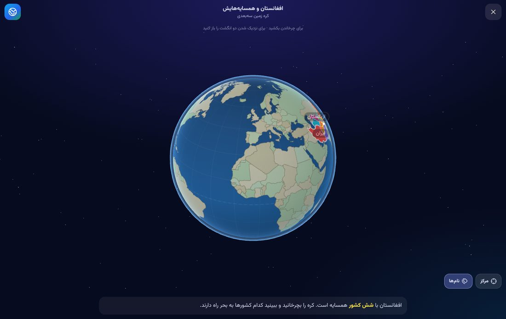

# دانا — معلم هوشمند برای شاگردان افغانستان

**Dana** is a Farsi (Dari) AI teacher chatbot for school students in Afghanistan, built with Next.js and the official Anthropic SDK (Claude). Teachers upload school-book PDFs in the **Library**; Dana extracts the full text, stores it as memory, and teaches from the books with page citations.

<p align="center">
  
</p>

<p align="center">
  
</p>

<p align="center">
  
</p>

<p align="center">
  
</p>

## امکانات / Features

**گفتگو (Chat)**
- Fully right-to-left Farsi UI with the Vazirmatn font, designed mobile-first for phones.
- Teacher personality: patient, encouraging, uses Afghan school words (مکتب، صنف، شاگرد) and everyday Afghan examples, explains step by step, and ends with a check question. Answers in Pashto or English when the student writes in them.
- Answers stream in smoothly with animations. Markdown is rendered as clean UI, never raw `**`:
  - bold words become highlights;
  - headings get accent bars and steps get numbered badges;
  - tips become 💡 callout cards and tables become styled cards;
  - math is typeset with KaTeX;
  - code blocks have a copy button.
- **Teacher's board** (تخته): for math, physics and chemistry problems, Dana solves the problem on a chalkboard inside the chat, step by step, like a teacher in class.
  - Equations are written line by line with a moving piece of chalk, and short Dari notes explain each step.
  - Function graphs and geometry or physics sketches (triangles, angles, circles, force arrows) are drawn stroke by stroke.
  - The final answer is boxed.
  - A new board **opens full screen by itself** and is written slowly, step by step. A big control bar suits phones: play/pause, previous/next, replay, show all, and a **speed** button (آهسته / عادی / تیز, remembered on the device).
  - In the chat, the board stays as a compact card: tap it to open full screen again. Answers opened from history show complete and can be replayed.
  - Keyboard in full screen: Space play/pause, ← next, → previous, Esc close.
- **Duolingo-style exams** (آزمونک): Dana's quiz appears as an exam card in the chat; it opens full screen when the student presses «شروع آزمون» (never by itself).
  - One question at a time, with a progress bar, a 🔥 streak, big 3D answer buttons, «بررسی» (check) and «نمی‌دانم» (I don't know), and a green/red feedback sheet with the explanation. There are small sounds (they can be muted) and confetti.
  - The results screen shows the score, time and best streak, with «تمرین اشتباهات» (practice mistakes) and «دوباره» (retry).
  - **«برگشت به دانا و فرستادن نتیجه»** returns to the chat and sends the result as a card; Dana then explains each mistake. Quiz mode switches off so she explains instead of quizzing again.
  - Keyboard: 1–4 choose, Enter checks/continues, Esc exits.
- **Interactive visuals** that open full screen by themselves once, for a new answer, and stay as a small card in the chat:
  - **3D Earth** (```` ```globe ````) for geography and history: highlighted countries with Dari names, cities, and routes such as the Silk Road. Drag to turn and pinch to zoom. The map is bundled (Natural Earth 1:110m), so no map images are downloaded.
  - **3D molecules** (```` ```molecule ````): ball-and-stick models with single, double and triple bonds and a Dari legend of the elements. There are 13 built-in molecules (water, CO₂, methane, ammonia, ethanol, benzene, a salt crystal…). Any other molecule is laid out with a small VSEPR model, so water is bent, ammonia is a pyramid and benzene is flat.
  - **Physics experiments** (```` ```sim ````) with sliders and live formulas: projectile motion (earlier throws stay as faint trails to compare), pendulum, inclined plane with force arrows, an electric circuit with moving electrons and a glowing bulb, and waves. Gravity can be set to Earth, Moon, Mars or Jupiter.
  - **States of matter** (```` ```sim ```` with `"type": "states"`): particles in a jar change from a vibrating solid to a sliding liquid to a fast gas as the temperature slider passes the melting and boiling points.
- **Room to read:** answers use the full width; the top bars slide away while scrolling down and come back when scrolling up; and the message box is a single line until it is tapped.
- Chips under the input box (shown when it is tapped): 📎 attach a photo or PDF (photos are compressed for slow internet), 💡 تفکر عمیق (deeper thinking), 📝 آزمونک (quiz mode), 🌐 جستجوی وب (web search). Small coloured dots show which modes are on.
- A model picker (دانا پیشرفته / سریع / سبک) and a book picker that limits answers to chosen books.
- Claude-style features:
  - stop, regenerate, and edit-and-resend;
  - copy and 👍/👎 on answers;
  - a collapsible "thinking" panel and live tool-status chips;
  - source chips that open the exact book page;
  - automatic chat titles;
  - chat history grouped by date, with search (Ctrl+K), rename and delete.
- Chats are saved in the browser (IndexedDB), so no accounts are needed.

**کتابخانه (Library)**
- **Bulk upload:** drop or select one PDF or many (e.g. all grade 11 books at once, up to 30). The subject and grade are guessed from each file name (e.g. «فزیک صنف یازدهم.pdf», `riazi-11.pdf`). A «صنف همه کتاب‌ها» picker presets the grade (remembered on the device), and every row can be corrected before starting.
- **Reading happens on the server, in the background.** The browser only uploads each PDF (one after another, with a percentage). After that the page can be closed: the server keeps reading the books and they are «آماده» next time the Library is opened.
- **Hybrid extraction**: the server reads the text layer for free. Each page is checked for problems that are common in Farsi PDFs: scanned pages, broken font encodings, and text stored backwards (visual order). Only those pages are sent to Claude, which reads them as PDF pages. An option can make Claude read every page.
- Live progress, resume for books with unread pages, a page-by-page text preview (with «خواندن دوباره این صفحه با هوش مصنوعی» to re-read one page), "ask about this book", and delete.
- Search runs on Postgres with Farsi-aware normalization and stemming. Claude searches the books through the tools `search_books` and `read_book_pages` and cites pages.

## How it works

```
Browser                          Server (Next.js route handlers)                         Claude
───────                          ───────────────────────────────                         ──────
upload PDF ──▶ Vercel Blob (or PUT /api/books/:id/file → ./.data/uploads)
POST /api/books/:id/start ──▶ /api/worker ─ after() ─▶ text layer (unpdf) ─ quality check ─▶ Postgres
                                   ▲                    bad pages → 2-page PDF (pdf-lib) ──▶ reads the pages
                                   └── starts the next run itself while work remains
chat input ──────────────────▶ POST /api/chat (NDJSON stream) ◀─────────────────────▶ teacher + book tools
```

- `app/api/chat/route.ts` runs a streaming tool-use loop (`client.beta.messages.stream`) with adaptive thinking, prompt caching and **server-side refusal fallback** (`fallbacks: "default"`), then streams events to the browser.
- `lib/prompts/teacher.ts` holds the teacher persona and the formatting rules the UI relies on.
- `lib/pdf/quality.ts` holds the page-quality heuristics; `lib/persian.ts` handles Farsi normalization and tokenization.
- The board is a ```` ```board ```` block in Claude's answer with one JSON object per line (`title`, `step`, `math`, `text`, `graph`, `draw`, `answer`), so steps appear while the answer streams. `lib/board/parse.ts` parses it, tolerating LaTeX backslashes the model forgot to escape. `lib/board/expr.ts` is a small safe expression compiler for graphs (no `eval`), and `components/board/` renders the chalkboard.
- **Background worker** (`lib/server/worker.ts`, `app/api/worker/route.ts`):
  - Each run answers at once and works inside Next.js `after()` for about 200 seconds, within the route's 300-second limit.
  - It saves its progress in the `books` table (phase, pages checked, pages left for Claude) and then calls `/api/worker` again, so a book of any size is finished in steps.
  - A lease (`lease_until`, claimed with `FOR UPDATE SKIP LOCKED`) makes sure two runs never read the same book; at most 2 books are read at once.
  - Opening the Library restarts a run that was cut off, and a daily cron in `vercel.json` is the last safety net.
- Large PDFs go straight from the browser to Vercel Blob, because Vercel functions accept at most a 4.5 MB request body.
- Visuals are ```` ```globe ````, ```` ```molecule ```` and ```` ```sim ```` blocks with one JSON object each (`lib/visuals/parse.ts`). The molecule layout and the physics formulas are pure functions (`lib/visuals/molecules.ts`, `lib/visuals/physics.ts`). three.js and the map load only when a visual is opened.

## اجرا روی کمپیوتر / Run locally

Requires Node.js 20 or newer.

```bash
npm install
cp .env.example .env.local     # put your ANTHROPIC_API_KEY in it
npm run dev
```

Open http://localhost:3000. Without `DATABASE_URL`, books are stored in an embedded database in `./.data`, and uploaded PDFs in `./.data/uploads`.

To try the UI without an API key, set `MOCK_AI=1` in `.env.local`. Demo answers depend on the question:
- an equation, Newton's second law or a right triangle shows the board;
- «همسایه‌های افغانستان» shows the 3D Earth;
- «شکل مولکول آب» shows a molecule;
- «حرکت پرتابی» shows the projectile experiment;
- «ذوب و جوش آب» shows the states of matter.

## نشر روی Vercel / Deploy on Vercel

1. Push this repository to GitHub and import it in Vercel.
2. In the project, open **Storage** and add a **Neon Postgres** database. In the **Connect a Project** dialog:
   - **Environments:** Production and Preview (add Development only if you want the same database locally).
   - **Create database branch for deployment:** leave both unchecked, so every deployment uses the same books.
   - **Custom Prefix:** type `DATABASE`, so the variable is `DATABASE_URL`. The app also accepts `STORAGE_URL` if you keep the default.
   - **Sensitive:** leave on, then click **Connect**.
3. Add a **Blob** store with **public** access. This creates `BLOB_READ_WRITE_TOKEN`. It is **required**: the server reads the books from there in the background. Without it, the Library shows a setup notice.
4. In **Settings → Environment Variables**, add `ANTHROPIC_API_KEY`.
5. **Redeploy** (Deployments → … → Redeploy): new variables only apply to new deployments. Tables are created automatically on the first request.
6. Check: `https://<your-site>/api/books` should return `"configured":true`.

The chat and worker routes can run for up to 300 seconds, the Hobby plan limit. `vercel.json` adds a daily cron that calls `/api/worker`.

Optional variables:
- `VERCEL_AUTOMATION_BYPASS_SECRET` lets the worker call itself on preview deployments that have Vercel Authentication on.
- `OCR_MODEL` sets the model that reads scanned pages.
- `WORKER_BUDGET_MS` sets the length of one worker run (default 200000).

## Costs and notes

- The default model is **Claude Opus 5.5** (`claude-opus-5-5`). Students can switch to Sonnet 5.5 or Haiku 5.5 in the model picker.
- **Refusal fallback is on**: if a model declines a request for policy reasons, the API retries it automatically on a fallback model.
- Reading a page with AI costs roughly a few cents on Opus 5.5. Set `OCR_MODEL` to a cheaper model if you prefer. Pages that extract cleanly cost nothing.
- Book reading continues on the server after the page is closed. Keep the page open only until the upload bar finishes. If some pages could not be read (for example, the API was busy), «ادامه پردازش» on the book card tries them again.
- Anyone who can open the site can upload and delete books. Add authentication before a public launch.

## Development

```bash
npm run test        # unit tests (vitest): Farsi text, PDF page checks, search, board, quiz, background worker, molecule shapes, physics formulas, visual specs
npm run lint
npm run typecheck
npm run build
```
