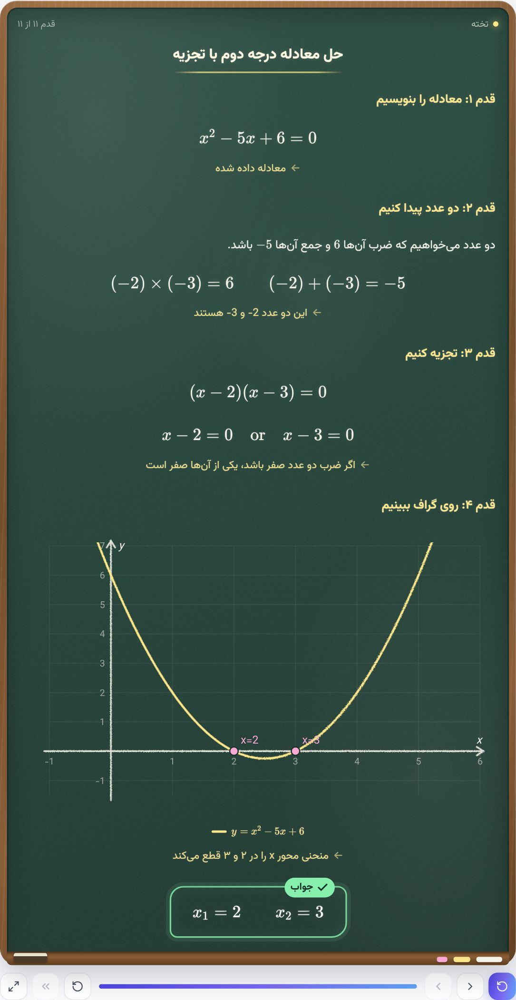
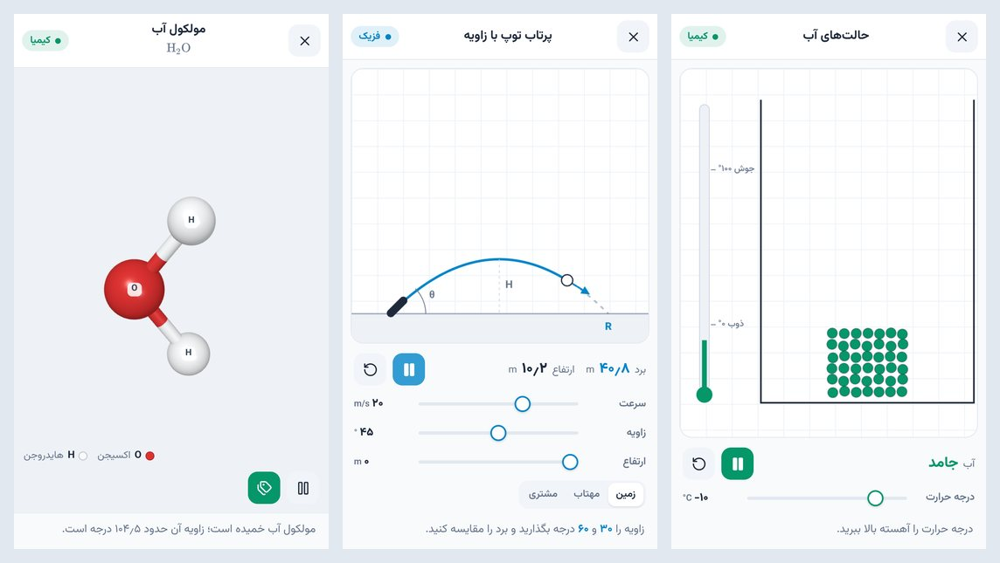
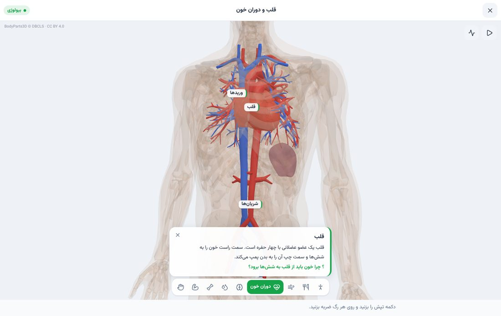

# هما سعادت — معلم هوشمند برای شاگردان افغانستان

**Homa Saadat** (هما سعادت) is a Farsi (Dari) AI teacher chatbot for school students in Afghanistan, built with Next.js and the official Anthropic SDK (Claude). Teachers upload school-book PDFs in the **Library**; Homa extracts the full text, stores it as memory, and teaches from the books with page citations.

<p align="center">
  
</p>

<p align="center">
  
</p>

<p align="center">
  
</p>

<p align="center">
  
</p>

<p align="center">
  
</p>

## امکانات / Features

**گفتگو (Chat)**
- Fully right-to-left Farsi UI with the Vazirmatn font, designed mobile-first for phones.
- Teacher personality: patient, encouraging, uses Afghan school words (مکتب، صنف، شاگرد) and everyday Afghan examples, explains step by step, and ends with a check question. Answers in Pashto or English when the student writes in them.
- Answers stream in smoothly with animations. Markdown is rendered as clean UI, never raw `**`:
  - bold words become highlights;
  - headings get accent bars and steps get numbered badges;
  - tips become 💡 callout cards and tables become styled cards;
  - math is typeset with KaTeX;
  - code blocks have a copy button.
- **Teacher's board** (تخته): for math, physics and chemistry problems, Homa solves the problem on a chalkboard inside the chat, step by step, like a teacher in class.
  - Equations are written line by line with a moving piece of chalk, and short Dari notes explain each step.
  - Function graphs and geometry or physics sketches (triangles, angles, circles, force arrows) are drawn stroke by stroke.
  - The final answer is boxed.
  - A new board **opens full screen by itself** and is written slowly, step by step. A big control bar suits phones: play/pause, previous/next, replay, show all, and a **speed** button (آهسته / عادی / تیز, remembered on the device).
  - In the chat, the board stays as a compact card: tap it to open full screen again. Answers opened from history show complete and can be replayed.
  - Keyboard in full screen: Space play/pause, ← next, → previous, Esc close.
- **Duolingo-style exams** (آزمونک): Homa's quiz appears as an exam card in the chat; it opens full screen when the student presses «شروع آزمون» (never by itself).
  - One question at a time, with a progress bar, a 🔥 streak, big 3D answer buttons, «بررسی» (check) and «نمی‌دانم» (I don't know), and a green/red feedback sheet with the explanation. There are small sounds (they can be muted) and confetti.
  - The results screen shows the score, time and best streak, with «تمرین اشتباهات» (practice mistakes) and «دوباره» (retry).
  - **«برگشت به هما و فرستادن نتیجه»** returns to the chat and sends the result as a card; Homa then explains each mistake. Quiz mode switches off so she explains instead of quizzing again.
  - Keyboard: 1–4 choose, Enter checks/continues, Esc exits.
- **Interactive visuals** that open full screen by themselves once, for a new answer, and stay as a small card in the chat. They are kept calm and simple: one colour per subject (geography teal, chemistry green, physics blue), light textbook-style pages, and very little text.
  - **3D Earth** (```` ```globe ````) for geography and history: a real NASA satellite photo with mountain relief (the Hindu Kush stands out), country borders, rivers with Dari names (آمو دریا، هلمند، هریرود…), highlighted countries, cities, and routes such as the Silk Road. One button switches to a clean political map. Tap a country to see its Dari name. Drag to turn and pinch to zoom. All map data and images are bundled (under 1 MB compressed) and load only when the globe opens.
  - **3D molecules** (```` ```molecule ````): ball-and-stick models with single, double and triple bonds and a Dari legend of the elements. There are 13 built-in molecules (water, CO₂, methane, ammonia, ethanol, benzene, a salt crystal…). Any other molecule is laid out with a small VSEPR model, so water is bent, ammonia is a pyramid and benzene is flat.
  - **Physics experiments** (```` ```sim ````) with sliders and live formulas: projectile motion (earlier throws stay as faint trails to compare), pendulum, inclined plane with force arrows, an electric circuit with moving electrons and a glowing bulb, waves, **free fall** (a ball and a feather, with or without air), a **spring** with a live position–time graph, **collisions** of two carts (bouncing or sticking, momentum kept), a **convex lens** ray diagram (real and virtual images) and **refraction** of light with total internal reflection. Gravity can be switched between Earth, Moon and Jupiter.
  - **Chemistry experiments** (```` ```sim ````): the **Bohr atom** for elements 1–20 (protons, neutrons, electron shells), a **chemical reaction** where the atoms of a balanced equation break apart and form the products (with a check that both sides have the same atoms), a **pH scale** with indicator colours, H⁺/OH⁻ ions and everyday examples, and the **gas laws** with a piston, moving particles and a pressure gauge.
  - **States of matter** (```` ```sim ```` with `"type": "states"`): particles in a jar change from a vibrating solid to a sliding liquid to a fast gas as the temperature slider passes the melting and boiling points.
- **Room to read:** answers use the full width; the top bars slide away while scrolling down and come back when scrolling up; and the message box is a single line until it is tapped.
- Chips under the input box (shown when it is tapped): 📎 attach a photo or PDF (photos are compressed for slow internet), 💡 تفکر عمیق (deeper thinking), 📝 آزمونک (quiz mode), 🌐 جستجوی وب (web search). Small coloured dots show which modes are on.
- A model picker (هما پیشرفته = Claude Sonnet 4.6, هما سبک = Claude Haiku 5.5) and a book picker that limits answers to chosen books.
- Claude-style features:
  - stop, regenerate, and edit-and-resend;
  - copy and 👍/👎 on answers;
  - a collapsible "thinking" panel and live tool-status chips;
  - source chips that open the exact book page;
  - automatic chat titles;
  - chat history grouped by date, with search (Ctrl+K), rename and delete.
- Chats are saved in the browser (IndexedDB), so no accounts are needed.

**کتابخانه (Library)**
- **Bulk upload:** drop or select one PDF or many (e.g. all grade 11 books at once, up to 30). The subject and grade are guessed from each file name (e.g. «فزیک صنف یازدهم.pdf», `riazi-11.pdf`). A «صنف همه کتاب‌ها» picker presets the grade (remembered on the device), and every row can be corrected before starting.
- **Reading happens on the server, in the background.** The browser only uploads each PDF (one after another, with a percentage). After that the page can be closed: the server keeps reading the books and they are «آماده» next time the Library is opened.
- **Hybrid extraction**: the server reads the text layer for free. Each page is checked for problems that are common in Farsi PDFs: scanned pages, broken font encodings, and text stored backwards (visual order). Only those pages are sent to Claude, which reads them as PDF pages. An option can make Claude read every page.
- Live progress, resume for books with unread pages, a page-by-page text preview (with «خواندن دوباره این صفحه با هوش مصنوعی» to re-read one page), "ask about this book", and delete.
- Search runs on Postgres with Farsi-aware normalization and stemming. Claude searches the books through the tools `search_books` and `read_book_pages` and cites pages.

### Interactive human body for biology

Homa can include an `anatomy` block in biology answers. It opens a **real 3D human body**: [BodyParts3D](https://dbarchive.biosciencedbc.jp/en/bodyparts3d/), an adult male body built from medical scans by DBCLS (Japan). Students rotate and zoom, switch between eight body systems (digestive, breathing, blood, nerves, urinary, skeleton, muscles, skin), and tap any of 27 organs and bone groups to read a short Dari explanation and an understanding question. The organs Homa points out keep their colour, glow softly and get Dari labels; the rest of the body turns see-through, and the camera flies to them. A button makes the heart beat and the lungs breathe.

Try: «بدن انسان را سه‌بعدی نشان بده و کار قلب را توضیح بده.»

````markdown
```anatomy
{"title": "قلب و دوران خون", "system": "circulatory", "highlight": ["heart", "arteries", "veins"], "note": "روی قلب و رگ‌ها بزنید."}
```
````

- Systems: `digestive`, `respiratory`, `circulatory`, `nervous`, `urinary`, `skeleton`, `muscular`, `skin` (leave it out for the whole body). Organ keys, Dari names, explanations and questions are in `lib/visuals/anatomy.ts`. Older blocks with `"focus"`, `"all"` or `"skeletal"` still work.
- The model is one 1.6 MB file (`public/models/human-body.glb`), downloaded only when a body visual is opened and then reused. It is made by `scripts/build-body-model.mjs`, which merges about 870 BodyParts3D parts into 27 meshes, simplifies them to about 480,000 triangles and compresses them (meshopt).
- It shows organs, bones, muscles and the main blood vessels, not cells, alveoli or nerves; vessel colours are symbolic.

## How it works

```
Browser                          Server (Next.js route handlers)                         Claude
───────                          ───────────────────────────────                         ──────
upload PDF ──▶ Vercel Blob (or PUT /api/books/:id/file → ./.data/uploads)
POST /api/books/:id/start ──▶ /api/worker ─ after() ─▶ text layer (unpdf) ─ quality check ─▶ Postgres
                                   ▲                    bad pages → 2-page PDF (pdf-lib) ──▶ reads the pages
                                   └── starts the next run itself while work remains
chat input ──────────────────▶ POST /api/chat (NDJSON stream) ◀─────────────────────▶ teacher + book tools
```

- `app/api/chat/route.ts` runs a streaming tool-use loop (`client.beta.messages.stream`) with adaptive thinking and prompt caching, then streams events to the browser. Chat and titles have no app-level spending cap; estimated costs are still recorded (`lib/server/budget.ts`, `lib/server/pricing.ts`). Only AI book reading checks a spending limit.
- `lib/prompts/teacher.ts` holds the teacher persona and the formatting rules the UI relies on.
- `lib/pdf/quality.ts` holds the page-quality heuristics; `lib/persian.ts` handles Farsi normalization and tokenization.
- The board is a ```` ```board ```` block in Claude's answer with one JSON object per line (`title`, `step`, `math`, `text`, `graph`, `draw`, `answer`), so steps appear while the answer streams. `lib/board/parse.ts` parses it, tolerating LaTeX backslashes the model forgot to escape. `lib/board/expr.ts` is a small safe expression compiler for graphs (no `eval`), and `components/board/` renders the chalkboard.
- **Background worker** (`lib/server/worker.ts`, `app/api/worker/route.ts`):
  - Each run answers at once and works inside Next.js `after()` for about 200 seconds, within the route's 300-second limit.
  - It saves its progress in the `books` table (phase, pages checked, pages left for Claude) and then calls `/api/worker` again, so a book of any size is finished in steps.
  - A lease (`lease_until`, claimed with `FOR UPDATE SKIP LOCKED`) makes sure two runs never read the same book; at most 2 books are read at once.
  - Opening the Library restarts a run that was cut off, and a daily cron in `vercel.json` is the last safety net.
- Large PDFs go straight from the browser to Vercel Blob, because Vercel functions accept at most a 4.5 MB request body.
- Visuals are ```` ```globe ````, ```` ```molecule ````, ```` ```sim ```` and ```` ```anatomy ```` blocks with one JSON object each (`lib/visuals/parse.ts`). The molecule layout, physics formulas and chemistry (formula parser, equation balance, Bohr shells, pH, gas law) are pure functions (`lib/visuals/molecules.ts`, `lib/visuals/physics.ts`, `lib/visuals/chemistry.ts`). three.js, the map, the Earth photo and the body model load only when a visual is opened.

## اجرا روی کمپیوتر / Run locally

Requires Node.js 20 or newer.

```bash
npm install
cp .env.example .env.local     # put your ANTHROPIC_API_KEY in it
npm run dev
```

Open http://localhost:3000. Without `DATABASE_URL`, books are stored in an embedded database in `./.data`, and uploaded PDFs in `./.data/uploads`.

To try the UI without an API key, set `MOCK_AI=1` in `.env.local`. Demo answers depend on the question:
- an equation, Newton's second law or a right triangle shows the board;
- «همسایه‌های افغانستان» shows the 3D Earth;
- «شکل مولکول آب» shows a molecule;
- «حرکت پرتابی», «رقاصک», «سطح مایل»، «مدار», «موج», «سقوط آزاد», «فنر», «تصادم», «عدسیه» or «انکسار نور» shows a physics experiment;
- «ساختمان اتوم», «تعامل کیمیاوی», «تیزاب و قلوی» or «قانون گاز» shows a chemistry experiment; «ذوب و جوش آب» shows the states of matter;
- «قلب» or «سیستم هاضمه» shows the 3D human body.

## نشر روی Vercel / Deploy on Vercel

1. Push this repository to GitHub and import it in Vercel.
2. In the project, open **Storage** and add a **Neon Postgres** database. In the **Connect a Project** dialog:
   - **Environments:** Production and Preview (add Development only if you want the same database locally).
   - **Create database branch for deployment:** leave both unchecked, so every deployment uses the same books.
   - **Custom Prefix:** type `DATABASE`, so the variable is `DATABASE_URL`. The app also accepts `STORAGE_URL` if you keep the default.
   - **Sensitive:** leave on, then click **Connect**.
3. Add a **Blob** store with **public** access and connect it to the project. Both kinds of connection work: a read-write token (`BLOB_READ_WRITE_TOKEN`) or the newer keyless one (`BLOB_STORE_ID` + `BLOB_WEBHOOK_PUBLIC_KEY`, uploads through presigned URLs), also with a custom prefix. It is **required**: the server reads the books from there in the background. Without it, the Library shows a setup notice.
4. In **Settings → Environment Variables**, add `ANTHROPIC_API_KEY`.
5. **Redeploy** (Deployments → … → Redeploy): new variables only apply to new deployments. Tables are created automatically on the first request.
6. Check: `https://<your-site>/api/books` should return `"configured":true`.

The chat and worker routes can run for up to 300 seconds, the Hobby plan limit. `vercel.json` adds a daily cron that calls `/api/worker`.

Optional variables:
- `VERCEL_AUTOMATION_BYPASS_SECRET` lets the worker call itself on preview deployments that have Vercel Authentication on.
- `AI_BOOK_READING=1` permits Claude to read scanned or broken book pages only when `AI_BOOK_BUDGET_USD` is also positive and has remaining allowance. Otherwise only free text inside the PDF is saved and scanned pages are skipped (the book card says how many).
- `AI_BOOK_BUDGET_USD` is the cumulative spending cap for **books only**, in US dollars (default `0` = paid book reading paused). Missing, negative or invalid values also pause it. Existing book spending counts toward the cap; chat and title spending does not. The old `AI_BUDGET_USD` setting is ignored.
- `OCR_MODEL` sets the model that reads scanned pages (default `claude-sonnet-4-6`).
- `WORKER_BUDGET_MS` sets the length of one worker run (default 200000).

## Costs and notes

- **Models:** the most capable model the app uses is **Claude Sonnet 4.6** (`claude-sonnet-4-6`, $3 / $15 per million input / output tokens), the default for chat and book reading. Students can switch to **Claude Haiku 5.5** (`claude-haiku-5-5`, $0.10 / $0.50) in the model picker; chat titles always use Haiku 5.5. The server accepts no other model.
- **Books paused; chat uncapped:** `AI_BOOK_BUDGET_USD` defaults to `$0`, so background book reading, forced AI reading and manual page rereads cannot spend Claude credits, even if `AI_BOOK_READING=1` was already set. Existing saved books remain usable in chat, and free PDF text extraction continues. Chat and titles use the available Anthropic API balance without an app-level cap. Usage history is preserved; no database reset is needed. `/api/usage` reports total spending with `budgetUsd: null` and `remainingUsd: null`, plus a separate `books` object with its cap, spending and remaining allowance. To resume paid book reading later, set `AI_BOOK_READING=1` and a positive `AI_BOOK_BUDGET_USD` above the accumulated book spending, then redeploy. For a positive cap, estimates and in-flight requests can exceed it slightly; Anthropic's own account limits still apply.
- Rough costs on Sonnet 4.6: a chat answer is about 1–5 US cents (more with web search or long book quotes); a scanned page read by AI is about 1–2 cents. Pages that extract cleanly cost nothing. `OCR_MODEL=claude-haiku-5-5` makes book reading much cheaper.
- Book reading continues on the server after the page is closed. Keep the page open only until the upload bar finishes. If some pages could not be read (for example, the API was busy), «ادامه پردازش» on the book card tries them again.
- Anyone who can open the site can upload and delete books. Add authentication before a public launch.

## Credits

- 3D human body: [BodyParts3D](https://dbarchive.biosciencedbc.jp/en/bodyparts3d/), © The Database Center for Life Science (DBCLS), [CC BY 4.0](https://creativecommons.org/licenses/by/4.0/). Adapted: parts merged into organ groups, simplified and compressed (see `public/models/ATTRIBUTION.md`).
- Earth photo and relief: NASA Blue Marble and elevation imagery (public domain), via the [webgl-earth](https://github.com/turban/webgl-earth) project.
- Country borders and rivers: [Natural Earth](https://www.naturalearthdata.com/) (public domain), through `world-atlas`.

## Development

```bash
npm run test        # unit tests (vitest): Farsi text, PDF page checks, search, board, quiz, background worker, molecule shapes, physics and chemistry formulas, visual specs, the body model
npm run lint
npm run typecheck
npm run build
```
