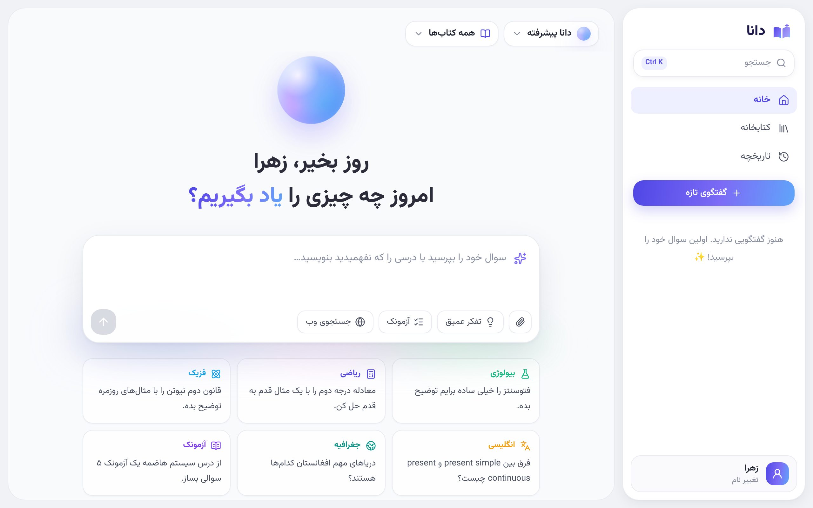

# دانا — معلم هوشمند برای شاگردان افغانستان

**Dana** is a Farsi (Dari) AI teacher chatbot for school students in Afghanistan, built with Next.js and the official Anthropic SDK (Claude). Teachers upload school-book PDFs in the **Library**; Dana extracts the full text, stores it as memory, and teaches from the books with page citations.

<p align="center">
  
</p>

## امکانات / Features

**گفتگو (Chat)**
- Fully right-to-left Farsi UI with the Vazirmatn font, designed mobile-first for phones.
- Teacher personality: patient, encouraging, uses Afghan school words (مکتب، صنف، شاگرد) and everyday Afghan examples, explains step by step, and ends with a check question. Answers in Pashto or English when the student writes in them.
- Answers stream in smoothly with animations. Markdown is rendered as clean UI, never raw `**`:
  - bold words become highlights;
  - headings get accent bars and steps get numbered badges;
  - tips become 💡 callout cards and tables become styled cards;
  - math is typeset with KaTeX;
  - code blocks have a copy button.
- **Interactive quizzes** (آزمونک): tap an answer and see right or wrong instantly, with an explanation and a final score.
- Chips under the input box: 📎 attach a photo or PDF (photos are compressed for slow internet), 💡 تفکر عمیق (deeper thinking), 📝 آزمونک (quiz mode), 🌐 جستجوی وب (web search).
- A model picker (دانا پیشرفته / سریع / سبک) and a book picker that limits answers to chosen books.
- Claude-style features:
  - stop, regenerate, and edit-and-resend;
  - copy and 👍/👎 on answers;
  - a collapsible "thinking" panel and live tool-status chips;
  - source chips that open the exact book page;
  - automatic chat titles;
  - chat history grouped by date, with search (Ctrl+K), rename and delete.
- Chats are saved in the browser (IndexedDB), so no accounts are needed.

**کتابخانه (Library)**
- Drag and drop a PDF, then choose the subject (Afghan curriculum) and grade (صنف ۱–۱۲).
- **Hybrid extraction**: the browser reads the text layer for free with pdf.js. Each page is checked for problems that are common in Farsi PDFs: scanned pages, broken font encodings, and text stored backwards (visual order). Only those pages are sent to Claude to read visually. An option can make Claude read every page.
- Live progress, resume for half-finished books, a page-by-page text preview, "ask about this book", and delete.
- Search runs on Postgres with Farsi-aware normalization and stemming. Claude searches the books through the tools `search_books` and `read_book_pages` and cites pages.

## How it works

```
Browser                                   Server (Next.js route handlers)            Claude
───────                                   ───────────────────────────────            ──────
pdf.js extracts page text ──quality check──▶ POST /api/books/:id/pages  ─▶ Postgres (pages + search terms)
bad pages → JPEG ─────────────────────────▶ POST /api/books/:id/ocr ──────────────▶ reads page images
chat input ───────────────────────────────▶ POST /api/chat (NDJSON stream) ◀──────▶ teacher + book tools
```

- `app/api/chat/route.ts` runs a streaming tool-use loop (`client.beta.messages.stream`) with adaptive thinking, prompt caching and **server-side refusal fallback** (`fallbacks: "default"`), then streams events to the browser.
- `lib/prompts/teacher.ts` holds the teacher persona and the formatting rules the UI relies on.
- `lib/pdf/quality.ts` holds the page-quality heuristics; `lib/persian.ts` handles Farsi normalization and tokenization.
- The PDF is processed in the browser because Vercel functions accept at most a 4.5 MB request body.

## اجرا روی کمپیوتر / Run locally

Requires Node.js 20 or newer.

```bash
npm install
cp .env.example .env.local     # put your ANTHROPIC_API_KEY in it
npm run dev
```

Open http://localhost:3000. Without `DATABASE_URL`, books are stored in an embedded database in `./.data`.

To try the UI without an API key, set `MOCK_AI=1` in `.env.local`.

## نشر روی Vercel / Deploy on Vercel

1. Push this repository to GitHub and import it in Vercel.
2. In the project, open **Storage**:
   - Add a **Neon Postgres** database. This creates `DATABASE_URL`.
   - Optionally add a **Blob** store with **public** access. This creates `BLOB_READ_WRITE_TOKEN` and keeps the original PDFs.
3. In **Settings → Environment Variables**, add `ANTHROPIC_API_KEY`.
4. Deploy. Tables are created automatically on the first request.

The chat and page-reading routes can run for up to 300 seconds, the Hobby plan limit.

## Costs and notes

- The default model is **Claude Opus 5.5** (`claude-opus-5-5`). Students can switch to Sonnet 5.5 or Haiku 5.5 in the model picker.
- **Refusal fallback is on**: if a model declines a request for policy reasons, the API retries it automatically on a fallback model.
- Reading a page with AI costs roughly a few cents on Opus 5.5. Set `OCR_MODEL` to a cheaper model if you prefer. Pages that extract cleanly cost nothing.
- Keep the Library tab open while a book is processing; the work runs in your browser. A half-finished book can be resumed.
- Anyone who can open the site can upload and delete books. Add authentication before a public launch.

## Development

```bash
npm run test        # unit tests (vitest): Farsi text, PDF page checks, search, streaming helpers
npm run lint
npm run typecheck
npm run build
```
